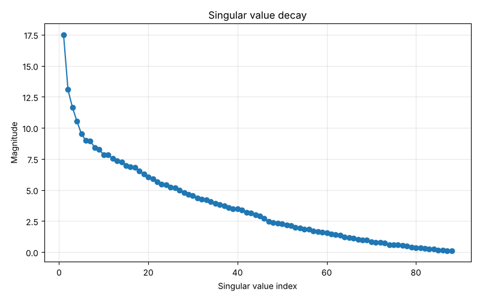
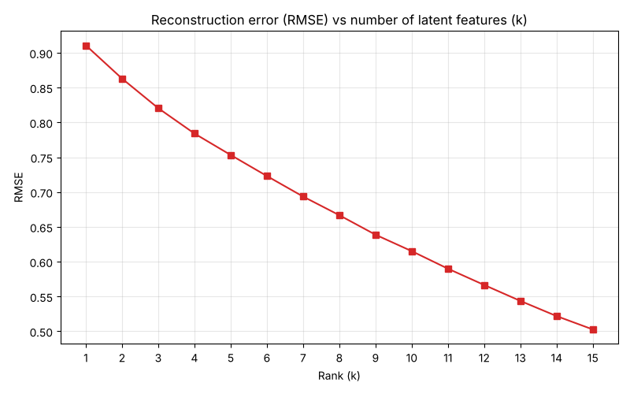

# SVD Movie Recommender

[](https://github.com/AlexandruAchilleF/svd-movie-recommender/actions/workflows/tests.yml)


A collaborative-filtering movie recommender on the **MovieLens 100k** dataset. The
Singular Value Decomposition is **implemented from scratch** with Householder QR
factorization and the QR algorithm. It does not call `numpy.linalg.svd`, which is only
used afterwards to check the result.

## How it works

1. **Rating matrix.** Load a users × movies matrix $R$ (missing ratings are `NaN`).
2. **Centering.** Fill each missing entry with the user's mean rating, then subtract that mean.
3. **QR factorization.** `qr_householder` builds $A = QR$ from Householder reflections
   $H = I - 2\frac{vv^T}{v^Tv}$.
4. **SVD.** `svd` runs QR iteration on $A^TA$ until it is diagonal. That yields
   $V$ and $\sigma_i = \sqrt{\lambda_i}$, and then $u_i = A v_i / \sigma_i$.
5. **Prediction.** Keep the top $k$ components, $\hat R = U_k \Sigma_k V_k^T + \bar r_u$,
   clipped to $[1, 5]$, and recommend the unseen movies with the highest scores.

The singular values match NumPy to within about $10^{-12}$.

## Project structure

```
svd-movie-recommender/
├── main.py                    # CLI entry point: runs the full pipeline
├── src/svd_recommender/
│   ├── linalg.py              # norms, Householder QR, SVD (from scratch)
│   ├── data.py                # MovieLens download and loading
│   ├── recommender.py         # SVDRecommender: prediction, RMSE, recommendations
│   └── plotting.py            # evaluation plots
├── tests/                     # pytest unit tests
└── docs/images/               # generated plots
```

## Getting started

```bash
git clone https://github.com/AlexandruAchilleF/svd-movie-recommender.git
cd svd-movie-recommender
pip install -r requirements.txt
python main.py
```

On first run, the dataset is downloaded from GroupLens into `data/`, which git ignores.
Options:

```bash
python main.py --user 5 --k 4 --top-n 5
```

Run `python main.py --help` for the full list, and `pytest` for the tests.

### Example output

```
L2 error of singular values vs numpy.linalg.svd: 1.2109e-12

Top 3 recommendations for user 2 (k=3):
  -> Shawshank Redemption, The (1994)  (predicted rating: 4.22 / 5)
  -> Pulp Fiction (1994)  (predicted rating: 4.20 / 5)
  -> Usual Suspects, The (1995)  (predicted rating: 4.16 / 5)
```

## Results

| Singular value decay | RMSE vs number of latent features |
| --- | --- |
|  |  |

The RMSE is measured on the observed (training) ratings, so it shows reconstruction
quality rather than generalization.

## Dataset

[MovieLens 100k](https://grouplens.org/datasets/movielens/100k/) by GroupLens Research,
University of Minnesota. It is not redistributed in this repository.
